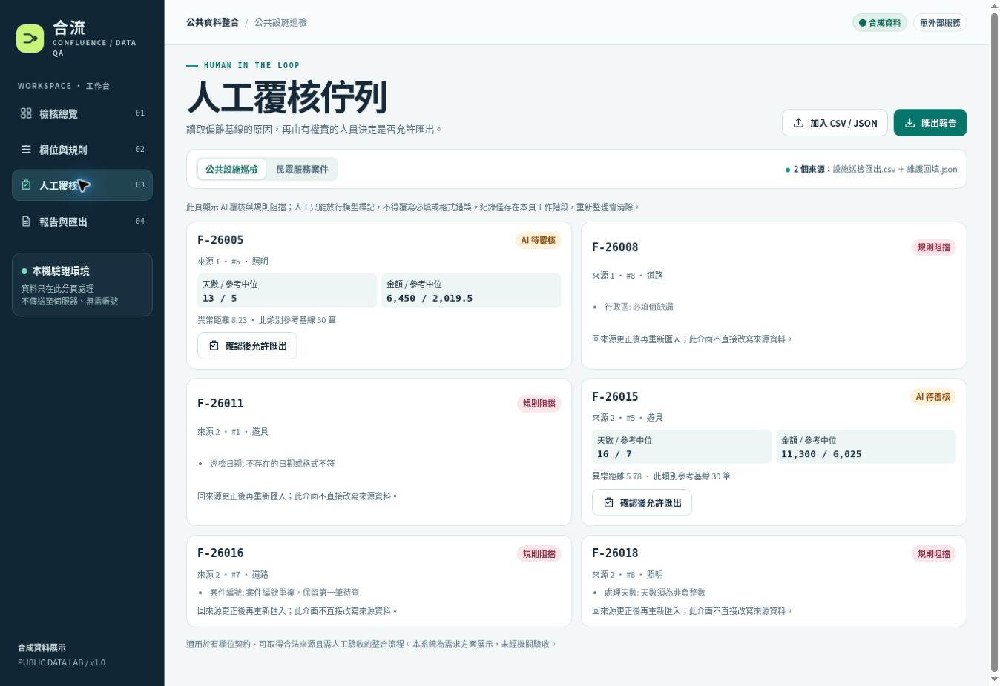

# 合流｜公共資料整合與品質檢核方案


**展示目的：** 案件或巡檢資料來自不同來源時，如何先對齊欄位、隔離不合規資料，再交付可回查的標準檔與檢核報告。示範環境採合成資料，**無委託機關或實際需求方，不是招標原文、投標實績或正式驗收證明**。

| 各來源如何對應共同欄位 | 規則錯誤與異常提示如何分流 |
| --- | --- |
|  |  |

[實際雙檔整併](docs/assets/06-integrated.jpg) · [報告與匯出](docs/assets/04-export.jpg) · [390 px 行動版](docs/assets/05-mobile.jpg) · [需求、交付與驗收矩陣](docs/REQUIREMENTS.md)

## 預設場域與流程

| 情境 | 資料現況（合成情境） | 方案目標 |
| --- | --- | --- |
| 公共設施巡檢 | 巡檢單與維護回填的欄名、日期及辦理狀態不同 | 對齊巡檢欄位、識別跨來源重複單號與不合理天數 |
| 民眾服務案件 | 受理案件與區域回填需彙總，時效與成本無共同檢核口徑 | 匯出可回查的合併紀錄，將異常送交承辦人覆核 |

**來源承辦匯出 → 整合承辦逐來源映射 → 規則阻擋或模型提示 → 業務覆核 → 核可資料與報告交付。** 角色為正式導入分工建議，展示介面未實作組織帳號或權限管控。

## 示範需求對照（非招標原文）

| ID | 可操作需求與交付 | 方案展示已涵蓋 |
| --- | --- | --- |
| REQ-01 | 多格式匯入、逐來源欄位對應 | UTF-8 CSV／陣列型 JSON；切換兩個場域，依共通七欄整併 |
| REQ-02 | 資料正規化及品質規則 | 日期、數值、狀態別名、跨來源編號去重；保留來源序號與資料列 |
| REQ-03 | 異常訊號與人員確認 | 自合成正常參考擬合類別基線；可調門檻、人工允許／撤銷；不得覆寫規則錯誤 |
| REQ-04 | 標準資料、檢核報告與安全交換 | 核可 CSV／JSON、列級檢核報告，另有合成摘要供「案跡」匯入 |
| REQ-05 | 前端驗證及可重跑交接 | 架構、範例、測試與畫面；無帳號、不對外送檔，離開分頁不保留工作狀態 |

## 啟動與驗收演練

```bash
python3 -m http.server 8080 --bind 127.0.0.1
# 開啟 http://127.0.0.1:8080/
npm test  # 另開終端；Node.js 20+，不需 npm install
```

1. 切換兩個預載場域。每個場域各 2 個不同欄名的來源，預設 **18 筆 = 12 通過＋2 待覆核＋4 阻擋**。格式調整筆數與通過筆數是對同一批次的獨立統計。
2. 「人工覆核」可看到異常紀錄與同類基線的差異。放行其中一筆後，**13 可匯出、1 待覆核、4 阻擋**。規則錯誤不允許放行；修改映射或規則會清除原有放行紀錄。
3. 加入[舊格式 CSV](examples/facilities-legacy.csv)，手動將「案件編號」對應至「巡檢郵件編號」；再加入[回填 JSON](examples/facilities-append.json)。預期 **6 筆 = 3 通過＋1 待覆核＋2 阻擋**（重複編號及不存在的日期）；標準 JSON 回查至來源 1 的第 1／2 筆、來源 2 的第 3 筆。首個匯入會替換內建批次，後續才追加。
4. 「報告與匯出」下載標準 CSV／JSON 和檢核報告。標準檔可以含使用者匯入的資料；檢核報告不含資料列原始值，仍含欄名與映射，分享前需審核。

**跨系統交付。** [案跡｜成果文件助手](https://github.com/JWJProjects/report-evidence-ai) 已實測匯入[瀏覽器匯出的合成摘要](examples/qa-evidence.json)，產生有來源線索的統計段落。交換格式維持 `portfolio.qa-evidence.v1`、`profile: policy`。僅純內建合成資料可用，只傳狀態計數，不傳原始內容、欄名、檔名或案件編號。這是手動檔案交換，不是兩套正式系統已介接。

**正式實作邊界。** 展示版用各類 30 筆、每場域 120 筆固定種子的合成正常參考，擬合中位數與 MAD 尺度；距離不是機率，不用於行政或服務資格決策。無基線類別不計分，需另行檢查。正式導入前須確認真實欄位、來源及使用授權、角色權限、留存、資料更新方式與驗收門檻；排程、API／SFTP、永久稽核、備援復原、容量／資安測試均未實作。

設計參考：[林試所評選文件](https://www.tfrin.gov.tw/redirect_files.php?file_name=APlNxDCEL605wNc2DoWGEqualFWYKWcdnr1delQpQQz8XNl9ex&id=65728) 的整合、相容穩定及測試／交接，[原民會評選文件](https://www.cip.gov.tw/data/bid/202604/T-25631375.pdf?c=1F3AF1A79C1A38425E85BF3C0BF38120&fn=6E2132260E059F3FEF3398801A45C73C&s=C0DAF6E2A93658F9) 的需求、可行性、分工及實績區隔，[政府資料品質參考](https://data.gov.tw/dataset/175299) 及 [數位發展部 AI 資源](https://web.moda.gov.tw/digital-affairs/digital-service/ai-resource/18248) 的機器可讀與驗證。僅參考公開文件中如何表達需求；本表由本專案自行設計，來源機關未委託或驗收，也未使用其業務資料、標誌或圖像。
