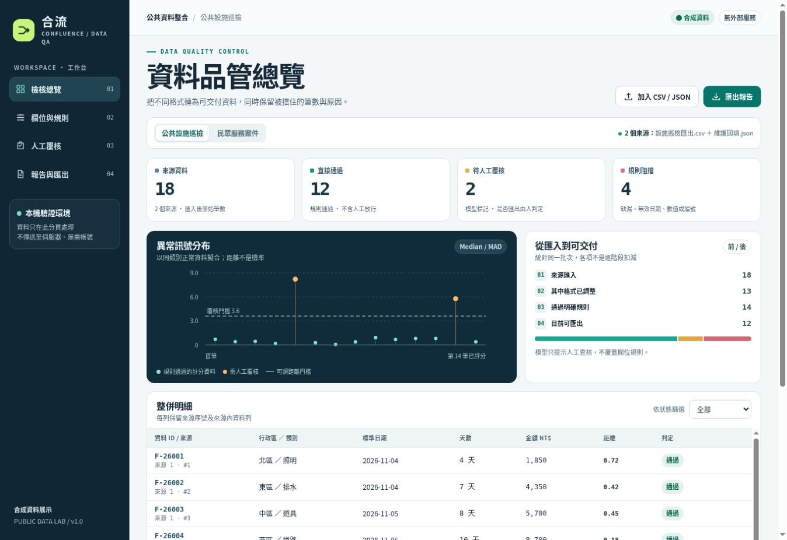
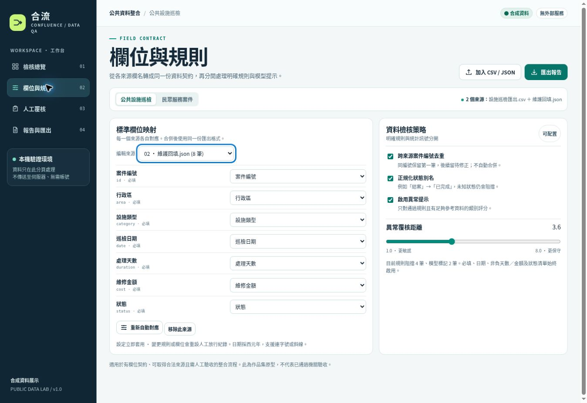

# 合流｜公共資料品管工作台

**把不同來源的 CSV／JSON 轉成同一份資料契約，分開處理格式錯誤與異常訊號，再交付可追溯的標準資料。** 這是可執行的作品集原型。兩套情境與參考樣本全為合成資料；不是既有機關系統、投標實績或驗收證明。



| 不同欄名如何整合 | 誰處理錯誤，哪些資料能交付 |
| --- | --- |
|  |  |

[報告與匯出實拍](docs/assets/04-export.jpg) · [390 px 手機實拍](docs/assets/05-mobile.jpg) · [實際雙檔整併驗證](docs/assets/06-integrated.jpg)

## 機關可以從原型看到什麼

- **整合既有作業，不先換掉原系統。** 每個來源各自對應欄位，再轉為共同欄位；含來源序號與來源內的資料列。公共設施巡檢與民眾服務案件共用流程，欄位名稱、分類、樣例和正常參考可切換。
- **把問題交還給正確的人。** 缺漏、無效日期、負值與重複等屬明確規則。AI 統計模型只提示相對同類資料偏離較大的紀錄；人員可以放行或撤回模型提示，但不能覆寫規則錯誤。原型不做行政、預算、查核或服務資格決定。
- **用資料與驗收證據交付。** 標準 CSV／JSON 只含規則通過且已核可的資料；另有 JSON 檢核報告回傳計數、映射、規則及列級處理狀態。CSV 保護易觸發試算表公式的文字；JSON 仍是資料，不可任意轉貼到允許執行公式的環境。
- **易於重跑。** 不需登入、不使用 API key、不安裝前端套件、不把檔案送到服務端；以本機 HTTP 供應靜態檔。重新整理會清除匯入與本頁的覆核，不宣稱已有永久稽核、分權或復原機制。

## 三分鐘驗收

```bash
# Python 3；只在本機啟動靜態伺服器
python3 -m http.server 8080 --bind 127.0.0.1
# 開啟 http://127.0.0.1:8080/
```

1. 啟動後使用「公共設施巡檢」，再切換「民眾服務案件」。每個預載情境各有 2 個不同欄名來源、18 筆合成紀錄；預設 12 筆直接通過、2 筆待模型覆核、4 筆規則阻擋。看總覽的「整併明細」及來源列。
2. 從「人工覆核」打開其中一筆 AI 待覆核，對照實值、同類參考中位數與距離，選「確認後允許匯出」。變成 13 筆可匯出、1 筆仍待覆核、4 筆仍阻擋。可撤回；變更映射或規則會清除原放行，避免沿用不適用的決定。
3. 載入 [設施舊格式 CSV](examples/facilities-legacy.csv)，首次匯入會替換內建合成資料。在「欄位與規則」把案件編號對應至「巡檢郵件編號」；再加入 [設施回填 JSON](examples/facilities-append.json)。預期 6 筆共通資料，3 筆通過、1 筆待覆核、2 筆阻擋（跨來源的重複編號和不存在的日期）。匯出的 3 筆 JSON 可回溯到來源 1 第 1／2 列、來源 2 第 3 列。來源列以第一筆資料為 1，非 CSV 實體行號。
4. 在「報告與匯出」下載標準 CSV／JSON，以及完整檢核報告 JSON。標準資料可能含自己匯入的內容，**檢核報告**不含來源欄位值；會列原始欄名和對應，因此仍需審視能否分享。格式錯誤的上傳會提示原因、不清掉原批資料。案件 ID 去重保留先到者，不自動猜哪一筆最新或最正確。

### 交換驗收摘要

「匯出合成 QA 證據」是給[案跡｜成果文件助手](https://github.com/JWJProjects/report-evidence-ai)的精簡介面：只在純內建合成樣本可用，只輸出固定欄位和加總。可下載 [瀏覽器實際匯出的樣本](examples/qa-evidence.json)。合約 `portfolio.qa-evidence.v1` 的 `profile` 為 `policy`，`synthetic` 為 `true`；`result` 內的通過（含已人工允許）、待覆核和阻擋合計等於總筆數。不傳原始欄位、案件編號、檔案名稱或意見文字。已用兩個實際瀏覽器介面完成交換：合流下載真檔，案跡匯入後產生來源可追溯的統計段落（18／13／1／4）。

## 分工、測試與導入邊界

| 交付能力 | 目前可跑 | 真正導入要確認 |
| --- | --- | --- |
| 欄位介接 | CSV 與陣列型 JSON、多來源映射、共同欄位、追溯、UTF-8；每檔 2 MB、整批 10,000 筆、每來源 40 欄 | 正式欄位字典、來源權責、API／SFTP／定時交換、相容版本與金額精度規格 |
| 品質處置 | 明確規則、MAD 異常提示、人工放行／撤回、匯出對帳 | 角色與權限、永久稽核、覆核時效、告警重送與回復、核准留存 |
| 上線交接 | 可重跑樣例、測試、唯讀本機原型 | 建立服務監控、容量與資安驗證、部署／備援操作、內部教育與正式驗收責任 |
| 協作角色 | 資料負責人決定欄位，整合工程配置，業務與 QA 對帳 | 依資料類別與介接範圍確認人日，沒有虛構價格、人力已到位或承接承諾 |

開發入口：`data.js` 定義場域欄名與合成基線；`engine.js` 包含解析、正規化、規則、擬合與計分；`app.js` 組合畫面、匯出、人工放行。第三種場域需新增資料契約、類別及已驗證的參考資料；目前共用 7 欄，不是任意欄型的無程式開發器。其他來源可在應用層建立 `{headers, rows}` 的相同介面；尚未實作 API/SFTP 連接器或排程服務。

**模型如何真的用到資料：** 訓練／擬合在瀏覽器中執行。由固定種子產生每類 30 筆正常參考（每場域 120 筆），從觀測值擬合各類的中位數及 MAD 尺度，給天數和金額設最低尺度避免除零，再以雙軸標準化距離和門檻標記候查。模型未用待查批資料重擬合，分數不是錯誤機率。類別少於 8 筆參考或無基線時不計分；有制度性變動、極端分布、未知類別及基線偏差時，請人工檢核，不能把合成結果當真實準確率。

```bash
# Node.js 20+；無需 npm install
npm test
# 選用：已配置 Python Playwright 與 Chromium 才需要，會重拍 README
python3 tests/browser-qa.py
```

政府文件只作為**設計參考**，不代表本案符合任一標案或已過驗收：參考 [林試所評選文件](https://www.tfrin.gov.tw/redirect_files.php?file_name=APlNxDCEL605wNc2DoWGEqualFWYKWcdnr1delQpQQz8XNl9ex&id=65728) 以確認系統整合、相容穩定與測試／交接的表達；參考 [原民會評選文件](https://www.cip.gov.tw/data/bid/202604/T-25631375.pdf?c=1F3AF1A79C1A38425E85BF3C0BF38120&fn=6E2132260E059F3FEF3398801A45C73C&s=C0DAF6E2A93658F9) 區分需求、可行性、分工及實績；以 [政府資料品質參考文件](https://data.gov.tw/dataset/175299) 與 [數位發展部 AI 資源](https://web.moda.gov.tw/digital-affairs/digital-service/ai-resource/18248) 補充機器可讀與模型驗證的表達方式。作品未使用上述機關資料、標誌或圖像。
